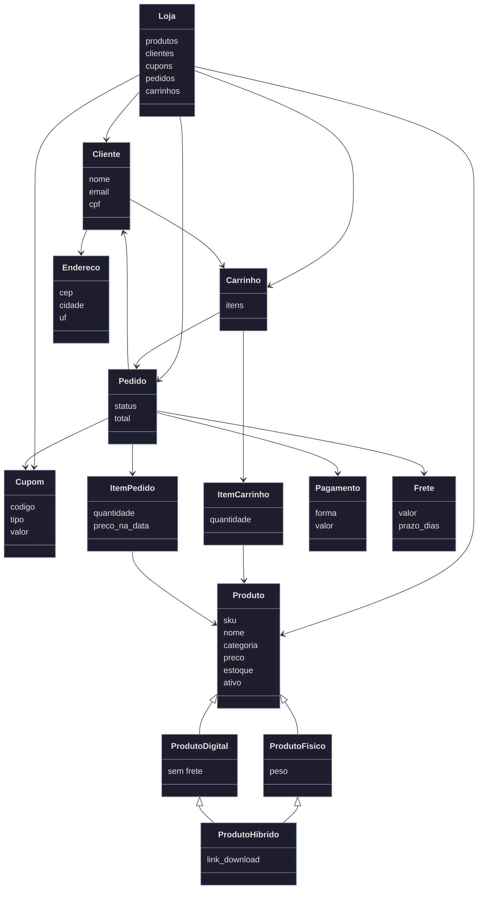

# Sistema de Loja Virtual Simplificada

## Descrição
Projeto da disciplina de Programação Orientada a Objetos (Tema 9).
Sistema de linha de comando (CLI) para uma loja virtual, com menus para gerenciar produtos, clientes e cupons,
montar carrinhos, fechar pedidos, pagar, enviar, entregar, cancelar e ver a nota e os relatórios de vendas.

## Objetivo
Praticar modelagem orientada a objetos (herança, inclusive múltipla, encapsulamento com `@property`,
validações e composição) construindo um sistema pequeno, com persistência em JSON, configurações em
`settings.json` e testes automatizados.

## Como executar

Os comandos devem ser rodados na pasta raiz do projeto:

```
python src/cli.py        # abre o menu da loja
python -m pytest         # roda os testes (precisa de: pip install pytest)
```

Na primeira execução o programa cria dados de exemplo (4 produtos, 2 clientes e 2 cupons: `DESC10` e `CURSO20`).
Para recomeçar do zero, apague os arquivos `.json` da pasta `data/`.

Exemplo de uso: menu `4` (Carrinho e pedidos) > adicionar item > fechar pedido (pode usar o cupom `DESC10`)
> pagar > enviar > entregar > ver nota. Depois, menu `5` (Relatórios).

## Estrutura do projeto

```
src/            código (classes, loja.py, dados.py, relatorio.py, configuracao.py, cli.py)
tests/          testes automatizados (pytest)
data/           arquivos JSON gerados pelo programa (não vão para o GitHub)
settings.json   configurações: frete, top N produtos, validade padrão de cupom, janela de cancelamento
```

## Menu do programa

- **Produtos:** cadastrar, editar, remover, entrada de estoque e listar
- **Clientes:** cadastrar, editar, adicionar endereço, remover e listar
- **Cupons:** cadastrar e listar
- **Carrinho e pedidos:** adicionar, remover e alterar quantidade de itens, ver carrinho, fechar pedido, pagar, enviar, entregar, cancelar e ver a nota
- **Relatórios:** pedidos, faturamento e ticket médio por período; produtos mais vendidos; vendas por categoria e por UF; pedidos por status

## Classes

Produto
- O que é: um item vendido na loja
- Principais dados: sku (único), nome, categoria, preço (maior que 0), estoque (0 ou mais), ativo

ProdutoFisico
- O que é: produto que tem peso e precisa ser enviado (herda de Produto)

ProdutoDigital
- O que é: produto que não paga frete (herda de Produto)

ProdutoHibrido
- O que é: produto com parte física e parte digital, como um livro impresso com e-book
- Herança múltipla: herda de ProdutoFisico e de ProdutoDigital
- Principais dados: peso e link de download. Paga frete, porque tem a parte física

Cliente
- O que é: quem compra
- Principais dados: nome, email válido, cpf válido, endereços

Endereco
- O que é: endereço de entrega do cliente
- Principais dados: cep (8 dígitos), cidade e uf (2 letras)

Carrinho e ItemCarrinho
- O que são: os produtos que o cliente quer comprar, antes de virar pedido. Cada item guarda o produto e a quantidade (1 ou mais)

Pedido e ItemPedido
- O que são: a compra "fechada". Cada item guarda a quantidade e o preço do dia da compra
- Tem um status: CRIADO → PAGO → ENVIADO → ENTREGUE (ou CANCELADO)

Pagamento
- O que é: o registro de um pagamento do pedido
- Principais dados: forma (PIX, CREDITO, DEBITO ou BOLETO), valor e data

Cupom
- O que é: desconto que pode ser aplicado no pedido
- Principais dados: código, tipo (VALOR ou PERCENTUAL), valor, validade, uso máximo e categorias elegíveis

Frete
- O que é: calcula quanto custa e quanto demora a entrega, pela tabela do settings.json

Loja
- O que é: guarda os dados enquanto o programa roda (produtos, clientes, cupons, pedidos e carrinhos) e salva tudo nos arquivos JSON

### Como se conectam

- Produto é a classe mãe de ProdutoFisico e ProdutoDigital
- ProdutoHibrido herda de ProdutoFisico e ProdutoDigital ao mesmo tempo
- Cliente tem um ou mais Enderecos e monta um Carrinho
- Carrinho tem vários ItemCarrinho, e cada um aponta para um Produto
- Carrinho vira um Pedido, que tem vários ItemPedido
- Pedido pertence a um Cliente, tem um Endereco de entrega, um Frete e vários Pagamentos
- Pedido pode usar um Cupom (opcional)
- Loja guarda produtos, clientes, cupons, pedidos e carrinhos

### Métodos principais

- Produto: `entrada_estoque`, `__str__`, `__repr__`, `__eq__` (compara pelo SKU) e `__lt__` (compara pelo preço)
- Cliente: `__str__`, `__repr__` e `__eq__` (compara por CPF ou email)
- Endereco: `__str__` e `__repr__`
- Carrinho: adicionar_item, remover_item, alterar_quantidade, subtotal, fechar_pedido, `__len__` (quantidade total de itens) e `__str__`
- Pedido: pagar, enviar, entregar, cancelar, gerar_resumo (a nota do pedido), total, `__str__` e `__repr__`
- Cupom: valido, aplica_a, usar e calcular_desconto
- Frete: calcula valor e prazo pela cidade ou pela UF

## Regras de negócio

- **Estoque:** só cria o pedido se a quantidade for menor ou igual ao estoque. O estoque baixa quando o pedido é pago, volta se um pedido pago for cancelado e aumenta com a entrada de mercadoria.
- **Produto inativo:** não pode ser colocado no carrinho nem vendido.
- **Cupom:** só vale dentro da validade, antes do uso máximo e para itens de categorias elegíveis. O valor precisa ser maior que zero (e até 100 se for percentual). O desconto nunca deixa o total negativo.
- **Frete:** calculado ao fechar o pedido, pela cidade ou pela UF do endereço escolhido. Produto digital não paga frete.
- **Pagamento:** aceita pagamento parcial. O pedido vira PAGO quando o total pago cobre o total do pedido.
- **Estados:** CRIADO → PAGO → ENVIADO → ENTREGUE. Só dá para cancelar pedido CRIADO ou PAGO.
- **Cancelamento:** pedido CRIADO (ainda não pago) pode ser cancelado a qualquer momento. Pedido PAGO só pode ser cancelado dentro da janela de horas do `settings.json`, contada a partir da criação do pedido, e o estoque é devolvido.
- **Expedição:** ao enviar, gera um código de rastreio fictício. Ao entregar, guarda a data de entrega.
- **Cliente e endereço:** para fechar o pedido o cliente precisa ter endereço, e CPF, email, CEP e UF precisam ser válidos.
- **Unicidade:** não permite SKU repetido nem cliente com CPF ou email repetido.

## Configurações (settings.json)

- `frete`: tabela de valor e prazo por cidade (chave `Cidade/UF`), por UF e um valor padrão para as demais
- `top_n_produtos`: quantos produtos aparecem no relatório de mais vendidos
- `validade_padrao_cupom_dias`: validade de um cupom novo quando nenhuma data é informada
- `janela_cancelamento_horas`: tempo em que um pedido pago ainda pode ser cancelado

Se o arquivo não existir, o programa usa valores padrão iguais aos do arquivo.

## Persistência

Arquivos JSON na pasta `data/`: produtos, clientes, cupons (com a contagem de usos) e pedidos.
Os produtos guardam o tipo (físico, digital, híbrido ou comum), então voltam como a classe certa ao carregar.
Os pedidos são salvos como resumo, com a lista de itens e a UF de entrega. A rotina de seed (`criar_seed`, em `dados.py`) cria os dados de exemplo na primeira execução.

## Relatórios

- **Pedidos, faturamento e ticket médio por período:** lista os pedidos entre duas datas e soma só as vendas (pedidos pagos, enviados ou entregues)
- **Produtos mais vendidos:** os N produtos com mais unidades vendidas
- **Vendas por categoria e por UF:** valor vendido em cada categoria e em cada UF
- **Pedidos por status:** quantidade e porcentagem de pedidos em cada status

## Testes

44 testes com pytest (`test_classes.py`, `test_regras.py` e `test_relatorios.py`), cobrindo casos de sucesso e de erro:
validações dos atributos, carrinho, estoque (insuficiente, baixa, estorno e entrada), cupom (expirado, uso máximo,
categoria e valores inválidos), frete por UF e cidade, produto digital e híbrido, pagamento parcial e total,
estados do pedido, cancelamento e janela de cancelamento, endereço inválido e os 4 relatórios.

## Decisões de implementação

- O desconto do cupom é calculado uma vez, quando o pedido é criado, e fica guardado. Assim o total de um pedido antigo não muda depois.
- Os cálculos dos relatórios são funções que recebem a lista de pedidos, o que facilita testar.
- Só pedidos pagos, enviados ou entregues contam como venda nos relatórios.
- Todas as validações lançam `ValueError`, e o menu mostra a mensagem sem quebrar o programa.
- A janela de cancelamento vale só para pedidos pagos, porque um pedido ainda não pago não tem estoque nem pagamento para desfazer.

## Limitações conhecidas

- Os pedidos de execuções anteriores aparecem nos relatórios, mas não podem mais ser pagos, enviados ou cancelados depois que o programa é fechado (só o resumo deles é salvo).
- Cada cliente tem no máximo um carrinho aberto, guardado em memória enquanto o programa roda.

## Diagrama (UML)

